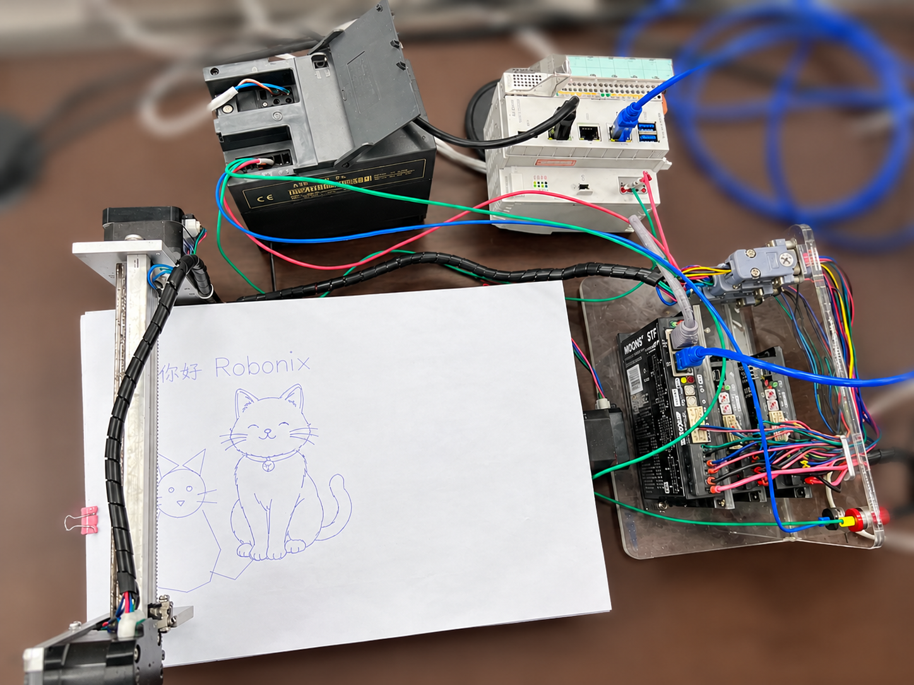

# XYZ Cartesian Pen Plotter

Robonix deployment for a desktop three-axis XYZ Cartesian pen plotter
(`robot-hdu-cartesian`). The robot writes and draws on a 180 mm × 150 mm
sheet with a single pen. It has no chassis, no arm joints, no camera, and no
autonomous motion: an external PLC owns interpolation, limits, and the
emergency stop, while Robonix only sends validated millimetre waypoints.



## Hardware

| Component | Model | Deployment configuration |
| --- | --- | --- |
| Motion | XYZ Cartesian gantry | Three linear axes; 180 mm × 150 mm travel; paper origin at the lower-left corner, +X right, +Y up |
| Controller | MatrixBox MX4001 PLC | TCP server at `192.168.1.135:2000`; framed `SOF 0xAA55`, `CMD`, `LEN`, `SEQ`, `PAYLOAD`, `CRC16-Modbus`; one motion command in flight, point-by-point ACK |
| Tool | Single pen | Pen-up `z=-46` mm, pen-down `z=-50` mm; no pen changer, pressure control, or ink sensing |
| Compute | Robonix host | VMware on Windows PC |
| Paper | 180 mm × 150 mm | Machine zero `(0,0,0)` is 50 mm above the paper's lower-left corner |

The PLC address, pen heights, motion profile, and provider IDs are defined in
[`robonix_manifest.yaml`](robonix_manifest.yaml) and overridden with
machine-local values in the git-ignored `robonix_manifest.local.yaml`. The body
hierarchy, footprint, and capability boundaries are defined in
[`soma.yaml`](soma.yaml) and [`urdf/xyz_plotter.urdf`](urdf/xyz_plotter.urdf).

Geometry is millimetres everywhere: paper coordinates, waypoints, workspace
limits, and PLC payloads. The URDF is description-only and never used for
control.

## Deployment layout

```text
robot-hdu-cartesian/
├── robonix_manifest.yaml          # production manifest: system + primitive + 2 skills
├── robonix_manifest.local.yaml    # git-ignored local credentials/host override
├── soma.yaml                      # robot body and capability description
├── urdf/xyz_plotter.urdf          # base_link -> x/y/z sliders (description only)
├── pyproject.toml                 # shared uv environment for all packages
├── uv.lock
├── .python-version
├── scripts/uv_sync.sh             # serialized uv sync used by package builds
├── (PLC protocol + geometry are vendored per package; no shared SDK/)
├── docs/
│   ├── ARCHITECTURE.md
│   └── PLC_PROTOCOL.md
└── packages/
    ├── primitives/primitive-hdu-cartesian-plotter-rbnx/   # device layer: PLC/TCP + motion
    └── skills/
        ├── skill-write_text-rbnx/                     # text -> waypoints
        └── skill-draw-rbnx/                           # scene / image / prompt -> waypoints
```

| Layer | Package | Contracts | Responsibility |
| --- | --- | --- | --- |
| primitive | [`primitive-hdu-cartesian-plotter-rbnx`](packages/primitives/primitive-hdu-cartesian-plotter-rbnx/README.md) | `robonix/primitive/plotter/{driver,trajectory,home,set_params,status,geometry}` | The only package that talks TCP to the PLC; coordinates and motion parameters only |
| skill | [`skill-write_text-rbnx`](packages/skills/skill-write_text-rbnx/README.md) | `robonix/skill/write_text/{driver,write}` | Turns Chinese/English text into pen strokes |
| skill | [`skill-draw-rbnx`](packages/skills/skill-draw-rbnx/README.md) | `robonix/skill/plot/{driver,config,draw_scene,draw_prompt,render_preview,draw_image,list_images}` | Declarative scenes, prompt-to-image, debug previews, and traced images |

Text and drawing share the same primitive but have disjoint configuration and
tool surfaces. Keeping them in separate packages keeps each `config.spec`
small and prevents text-only fields such as `font_size_mm` from leaking into
the drawing tools.

The primitive must be declared before the skills. `rbnx boot` has no
defer/retry, and a skill resolves `robonix/primitive/plotter/*` when it is
first activated.

## Prepare

The primitive and both skills share one uv-managed environment at the
repository root (`pyproject.toml`, `uv.lock`, `.python-version`, `.venv/`).
Install [uv](https://docs.astral.sh/uv/) once, then:

```bash
uv lock          # first checkout and after changing dependencies
uv sync --locked
```

Commit `uv.lock` after dependency changes; `.venv/` stays local.

The Robonix Python runtime itself (`robonix_api`, `grpcio`, `fastmcp`) is pinned in [`pyproject.toml`](pyproject.toml) and is still injected at process start via
`rbnx path robonix-api`.

Copy the deployment manifest to the git-ignored local file and fill in the
machine-specific values:

```bash
cp -n robonix_manifest.yaml robonix_manifest.local.yaml   # keep an existing local file
$EDITOR robonix_manifest.local.yaml
```

Set `system.pilot.vlm.upstream`, `system.pilot.vlm.api_key`,
`system.pilot.vlm.model`, and the PLC `primitive.config.host`. The checked-in
`robonix_manifest.yaml` keeps those fields empty on purpose.

> **Never commit or share `robonix_manifest.local.yaml`.** `.gitignore`
> excludes `*.local.yaml`, but the file may contain a live VLM API key. Do not
> paste the file or its `api_key` into issues, chat, logs, or screenshots. If a
> key is exposed, rotate it immediately. Keep the checked-in manifest free of
> credentials.

For the related PLC-side deployments, please see https://github.com/HDU-FROST/PLC-cartesian.

The PLC must be reachable before boot when `connect_on_init: true`. Confirm
TCP port 2000 is open; ICMP may be disabled on the PLC:

```bash
nc -z 192.168.1.135 2000 && echo "PLC TCP reachable"
```

## Build and boot

```bash
rbnx build
rbnx boot -f robonix_manifest.local.yaml
rbnx caps | grep -E 'primitive/plotter|skill/write_text|skill/plot'
rbnx chat
```

Stop the stack with:

```bash
rbnx shutdown -f robonix_manifest.local.yaml
```

`rbnx build` runs each package's `scripts/build.sh`, which invokes
`rbnx codegen` and generates the gRPC/MCP stubs consumed by the primitive and
the skills. Each build also runs `scripts/uv_sync.sh`, so the root `.venv` is
ready before the first boot. Re-run the build after changing any `.srv`,
`.msg`, or capability file.

Unit tests do not need Robonix, the PLC, or an image service:

```bash
uv run pytest \
  packages/primitives/primitive-hdu-cartesian-plotter-rbnx/tests \
  packages/skills/skill-write_text-rbnx/tests \
  packages/skills/skill-draw-rbnx/tests -q
```

Operator endpoints from the manifest:

- Atlas: `127.0.0.1:50051`
- Executor: `127.0.0.1:50061`
- Pilot: `127.0.0.1:50071`
- Liaison: `127.0.0.1:50081`

Example requests:

- `Write "Hello World" starting at x=10 mm, y=120 mm`
- `先回零，然后写两行：第一行 "XYZ"，第二行 "2026"`
- `Draw a circle, a rectangle, and a diagonal line on a 180x150 mm canvas`
- `画一只坐着的猫，用 lineart 模式画到纸上`
- `Preview the scene as a PNG before drawing it`

## Safety and bring-up order

The PLC has no `STOP` command. Once `MOVE_LINEAR` is sent, Robonix cannot
abort the move; use the PLC-side emergency stop. A failed job leaves the pen
where it stopped, and a power loss discards the absolute position.

Verify `z_down` by hand before the first run: too low punctures the paper, too
high draws nothing.

Bring-up order:

0. `rbnx caps` must list `robonix/primitive/plotter/geometry`; the skills read
   their drawable area and pen heights from it on activation.
1. Confirm the PLC is reachable and `plotter_home` completes.
2. Confirm the primitive status stream reports `connected` and `IDLE`.
3. Dry-run a short text or scene and check the point count and bounding box.
4. Draw a small test pattern in a clear workspace area.
5. Only then run larger jobs.

## Drawing policy

The Pilot/LLM calls `robonix/skill/plot/config` before planning a drawing
request. The returned flags (`debug`, `imagegen_ready`, `home_before_draw`,
`preview_name`) select one of two paths:

| Request | Path |
| --- | --- |
| Structured/geometric (shapes, coordinates, JSON) | `plotter_home` → `render_preview` (only when `debug=true`) → `draw_scene` |
| Free-form/illustrative and `imagegen_ready=true` | `plotter_home` → `draw_prompt`; on failure, author a simple scene and use `draw_scene` |

The skill enforces the same behavior even if the planner omits a step:
`draw_scene`/`draw_image`/`draw_prompt` home before the trajectory when
`home_before_draw: true`, and a non-dry-run `draw_scene` writes
`output_dir/last_preview.png` before moving when `debug: true`. Passing
`skip_home=true` / `skip_preview=true` prevents duplicate work after the
planner has already performed that step. Preview failures are warnings and
never block drawing.

## Robot description

[`soma.yaml`](soma.yaml) and [`urdf/xyz_plotter.urdf`](urdf/xyz_plotter.urdf)
are served by Soma. The description contains the body footprint, the
three-axis tree, and the complete capability boundary used by Pilot and other
consumers. See [`docs/ARCHITECTURE.md`](docs/ARCHITECTURE.md) for the layering
and data flow.

The robot cannot move its base, navigate, sense the environment, avoid
obstacles, change pens or colours, control pen pressure, or verify drawing
quality. Text is limited to ASCII letters/digits and the 3755 GB2312
level-1 hanzi in the vendored single-stroke font; punctuation is not
supported.

## License

MIT. See [LICENSE](LICENSE).